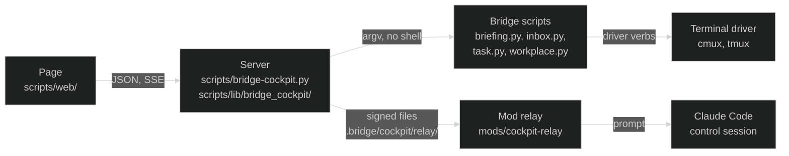

# Developing the Bridge cockpit

[`bridge-cockpit.md`](bridge-cockpit.md) is the user guide: switching it on, what the
page shows, the safety model, the relay, the files. This page is for changing it.

## 1. The three parts



- **Server** (Python stdlib only): collects the briefing, shapes it into one view
  model, polls the agent tabs, runs verbs, streams changes, writes relay records.
  All domain logic lives here; the page only renders.
- **Page** (Preact + htm, no build step): renders the model, sends verbs, holds
  only view state (selection, open drawers, the page tab).
- **Mod relay** (`mods/cockpit-relay`): the control session heartbeats, picks up
  signed questions and answers them as prompts. It does nothing else: no card,
  no command.

Everything the page does to an agent tab goes through `scripts/workplace.py`
and the terminal driver configured in `workplace.driver`
([`workplace.md`](workplace.md), "Writing a driver"): `workplace.py focus`
(Go to tab), `key` (Yes, No, a dialog's option), `screen` (the large tab view, what a waiting tab asks), `close` (Close
tab), `send` (a message, Go on) and `launch` (Do it, Advise me). The server asks
`workplace.py caps --json` once and then every few minutes
(`server.py driver_caps`), and a verb in `actions_base.py NEEDS_CAP` is refused with
`driver_cannot` when the driver does not serve it. So the server calls no
terminal directly for a tab; the cmux CLI stays only for the layout backup
(`skills/cmux/scripts/cmux_layout.py`, every `snapshot_minutes` and on "Save
layout now").

## 2. Where things live

| File | Job |
|---|---|
| `scripts/bridge-cockpit.py` | CLI: serve, start, open, url, status, stop, autostart (macOS login item), new-token |
| `scripts/lib/bridge_cockpit/config.py` | reads `cockpit` (formerly `briefing.web`) from `bridge-config.yaml`; a key it leaves out takes its default |
| `scripts/lib/bridge_cockpit/runner.py` | the one place that starts a subprocess: an allowlist of programs and exact argv shapes (the Bridge's scripts, the quick chat, the A2A calls, the codex and Haiku judges, and organize: `organize.argv_ok`, one `claude -p` without tools, settings or session, prompt at most 24000 characters; the themes, the Activity summary and the instruction line of Work through, each its own `argv_ok` and JSON schema; the two `git log` shapes of `activity.git_argv_ok`, `Runner.git`), timeouts, clean env |
| `scripts/lib/bridge_cockpit/collector.py` | collect pipeline (quick, full, delta), and `build_model`: the JSON the page gets |
| `scripts/lib/bridge_cockpit/origin.py` | where a work row comes from and whether it is a task or a stream: `classify_from` (an inbox item's free `from`), `classify_row` (a row), `work_kind`, `known_from_root` (the skills, declared runs, machines and work slugs of the tree, cached 30 s); pure, never raises |
| `scripts/lib/bridge_cockpit/card_fields.py` | the one contract of a card and of the `brief` it is written from: `CARD_FIELDS` (the wire shape), `BRIEF_LIMITS`, `validate_brief` (the gate every writer passes, and `validate-status.py` for a STATUS.md), `brief_basis` (when a brief is stale); pure. Its inputs come from `workplace.py tasks` (`--all` adds the backlog: brief, headline, `next_who`, `next_due`, progress) and the task detail payload of `details.py`, which carries the brief as a mapping |
| `scripts/lib/bridge_cockpit/brief_refs.py` | what a brief may point at: `reachable` (the bound repository and its issues, URLs, paths and task slugs that exist, at most `REFS_MAX`), `references` (the list the describe prompt carries), `resolutions` and `unresolved` (the check after the answer: a bare `#n` qualified with exactly one repository, a section without a place unresolved) and `parts` (a text as text, links and unresolved references, the card's `brief_refs`); pure, the disk only through callables |
| `scripts/lib/bridge_cockpit/card.py` | one card for every item: `card_of(raw, ctx)` maps a model row, a page item, a task or inbox detail and a tab that asks to exactly `CARD_FIELDS`, one adapter per kind; `probe_text` (a `closes_when` in words), `progress` and `placeholder_steps` (the checklist of a STATUS.md, `workplace.py` uses them too); pure, never raises |
| `scripts/lib/bridge_cockpit/model.py` | pure domain functions, first ported from the retired briefing card's `logic.ts` (buckets, layout, tab matching) |
| `scripts/lib/bridge_cockpit/actions.py` | `Actions`: the argument checks (`validate`), `execute`, the audit line, `finish`; it re-exports every name of `actions_base.py` |
| `scripts/lib/bridge_cockpit/actions_base.py` | the verb table `SPEC`, the patterns and word lists, `ActionError`, `Ctx` |
| `scripts/lib/bridge_cockpit/actions_*.py` | the `v_<verb>` handlers by area, each a part of `Actions`: `launch` (the shared pieces, the start of agents), `work` (inbox items and tasks), `tabs`, `chats` (quick chats, A2A, sessions, `/api/ask`), `pages` (start and settings page, a page row's steps) |
| `scripts/lib/bridge_cockpit/review.py` | the task check: `task.py review` on its own thread, the last run for the model |
| `scripts/lib/bridge_cockpit/sessions.py` | the Sessions page: running Claude sessions, their subagents and tab; the workflow runs of the last week bound to an open task (`run_task`, `refresh_runs`) for the Files view |
| `scripts/lib/bridge_cockpit/quick.py` | the chat: one short read-only `claude -p` per chat (Haiku default), streamed (`quick_live`), kept in `quick.json`, resume, cost per turn, handoff |
| `scripts/lib/bridge_cockpit/ticker.py` | the news ticker: settings (`cockpit.ticker` plus `ticker.json`), feed fetching and parsing (RSS, RDF, Atom), the cache `ticker-cache.json`, the Haiku editor on its own thread, and `state()`, the `ticker` key of the model and the payload of the SSE event `ticker` |
| `scripts/lib/bridge_cockpit/guide.py` | the decision guide: settings (`cockpit.session_guide` plus `guide.json`), a waiting tab's last turns from its transcript (`turns_of`, the screen as fallback), its first ask (`first_ask`) and its task's headline (`task_headline`) for the `about` line, the Haiku prompt and the parse of its answer (only steps safe to offer, a dialog step only one of the dialog's numbers, `RISKY_RE`), the auto reading after each tab poll (`on_tabs`, `per_hour`), one worker thread, `state()` as the `guide` key and SSE event |
| `scripts/lib/bridge_cockpit/net.py` | the one outbound fetcher, `fetch`, for feeds (ticker) and agent cards (agents): a scheme allowlist that also holds for redirects, no redirect into a private network unless the configured address is there, a size cap and a wall-clock deadline per caller |
| `scripts/lib/bridge_cockpit/details.py` | read-only detail endpoints: a task's STATUS.md and the files of its folder (`folder_files`, one read by `task_file`), an inbox item |
| `scripts/lib/bridge_cockpit/tabs.py` | tab poller over `workplace.py status --json`, and the questions of the waiting tabs (`_refresh_asks`) |
| `scripts/lib/bridge_cockpit/asks.py` | pure: what a waiting tab asks, read off its screen (`question_of`: text, options, hash, yes or no, draft; `draft_of`: only whether something is typed in the prompt) |
| `scripts/lib/bridge_cockpit/organize.py` | Organize with AI: `gather` (this Bridge's workspaces and tabs, scrubbed, `fit` within the prompt limit), `prompt`, `argv` and `argv_ok` (the one `claude -p` shape the runner lets through for it), `parse`, `items` (the checks that drop what is not safe to offer), `failure_code`, `Proposals` (in memory, 15 minutes) |
| `scripts/lib/bridge_cockpit/server.py` `driver_caps`, `backup_layout` | what the terminal driver serves; the cmux layout backup every `snapshot_minutes` |
| `scripts/lib/bridge_cockpit/watch.py` | stat-only watcher of `work/` and the relay folder |
| `scripts/lib/bridge_cockpit/relay.py` | relay records, HMAC signing, heartbeat reading |
| `scripts/lib/bridge_cockpit/store.py` | `state.json` (hidden rows, team runs) and `view.json` (last view) |
| `scripts/lib/bridge_cockpit/settled.py` | `work/cockpit/settled/`: every hide, settle and "show again" as one new file, tracked by git, so a settled row stays settled on every machine; the legacy keys of `state.json` migrate in once |
| `scripts/lib/bridge_cockpit/server.py` | HTTP: routes, auth, static files, SSE |
| `scripts/lib/bridge_cockpit/text.py` | server texts (notes, prompts to Claude), de and en |
| `scripts/lib/bridge_cockpit/agents.py` | A2A agents: the peers of `infra/a2a-peers/`, their public cards fetched through `net.py`, a conversation with each kept in `agents.json`, and the `a2a.py ask` and `get` shapes the runner lets through |
| `scripts/lib/bridge_cockpit/bridges.py` | the other Bridges on this machine for the chat: siblings and downstream instances of `infra/instances/` that have a clone here, neither read-only, dormant nor archived |
| `scripts/lib/bridge_cockpit/daybook.py` | the day book of the start page, `days.json`: each quota's use per day (rises add up, a fall is a reset) and the counts of each day, two weeks |
| `scripts/lib/bridge_cockpit/design.py` | the page's colours and fonts from the Bridge's own `DESIGN.md`, served as `/colors.css` |
| `scripts/lib/bridge_cockpit/graph.py` | the knowledge graph of the inner room: which config entry names which, with the open tasks and streams as nodes |
| `scripts/lib/bridge_cockpit/history.py` | `history.json`: every close, drop, settle or hide with its items and the inverse that takes it back |
| `scripts/lib/bridge_cockpit/jev.py` | Jev (TypeSafe): the rows sent for a rating or a page's order, the cache, the day's token total, the audit line only when a request left the machine |
| `scripts/lib/bridge_cockpit/launch.py` | the model and effort an agent tab starts with: `cockpit.launch_model` plus `launch.json`, the choice per start and the route |
| `scripts/lib/bridge_cockpit/returns.py` | the return channel: each start in `launches.json`, where it stands now (started, working, asks, idle, result, lost, done: `idle` a still tab whose screen, read, holds no question, or a tab back at its shell, `result` also a task note since the start that begins with the result head of `text.py` `returns.result`) and the one line written to its item when it ends |
| `scripts/lib/bridge_cockpit/triage.py` | the triage: `scripts/triage.py run` on its own thread and its last run for the page, each row with `next_rank` and `rank_at` from Jev's newest order of a work page while it is younger than `cockpit.flow.rank_max_age_days` |
| `scripts/lib/bridge_cockpit/usage.py` | the tokens Claude Code used, per Bridge and per machine, over 7, 30 or 90 days, read from the session transcripts |
| `scripts/web/index.html`, `theme.js` | page shell, light or dark before first paint |
| `scripts/web/app.js` | store, controller (`ctl`), event stream, keyboard |
| `scripts/web/components.js` | the root (`App`) and the page router; the rules every component keeps |
| `scripts/web/views/*.js` | the components, one file per area (header, day, detail, chat, tabs, pages, start page, stage, sessions, check, overlays, small parts, page ids); each reads the store `s`, calls the controller `c` and imports what it uses from the others |
| `scripts/web/views/dossier.js` | the Files view of the work tab: `DossierView` walks the one queue of `logic.js queueOf` (scope `dossier`, parts from `dossierParts`), one task at a time with its cover, its next step (`dossierStep`, derived, never stored) in the start page focus's `Hero`, its folded drawers from `/api/task` (Result from `logic.js fileResults`: the starts of the return channel and the workflow runs, a run checked by the verb `run_seen`; Files from `files`, one read in place by `/api/task?file=`), `FocusWalk` and `After`; on top `Find` (the search field and its results from `/api/find`), a found file outside the queue in `OpenFile` (`ui.dossierOpen`: its slug, or the folder of a closed copy, read by `/api/task?path=`), `AskBox` (a quick question with `logic.js fileContext` or `findContext` as its context) and `Suggest` (a read-only suggestion in the quick place `suggest`, written only by the verb `task_set_next`) |
| `scripts/lib/work_find.py` | the search over the work system, shared by `scripts/work-find.py` and the cockpit's `/api/find` (which runs that command): eligible files, `rg` as a narrowing step when installed, the same Python reading and ranking either way |
| `scripts/web/views/card.js` | the item card: `ItemCard` draws a row's or detail's `card` (card.py) in a detail head (the middle column, the item and info drawers, the files view's cover): summary, goal, story as one sentence, criteria as a list to read, next step, chips, progress, gaps; "AI" and "outdated" from the describe view; "Describe with AI" and a proposal's Apply, Edit and Discard (`describe_run`, `describe_apply`, `describe_discard`). `ItemCardLine` is a list row's sub line (its goal). `describeOf(s, key, ...)` reads the live view (`s.describe`) before the one a row or detail carries |
| `scripts/web/views/ticker.js` | the news ticker: `TickerBand` on the start page and `TickerSettings`, its group on the Settings page, drawn with the page's own `Card`, `Row` and `Switch` from `views/settings.js` |
| `scripts/web/markdown.js` | the Markdown reader for answers (Chat, A2A connections): text into plain blocks and runs, never HTML; `safeHref` keeps http(s) and mailto links only |
| `scripts/web/views/organize.js` | `OrganizeView`: the proposal grouped by workspace, nothing ticked, the ticks, Apply, and the applied, skipped and failed items in words |
| `scripts/web/views/guide.js` | the decision guide: `GuideTree` (the reading as a tree; a branch fills the box, Send or Press goes through `logic.js guideChoices`; To tab, Watch, What was read), `GuideLine`, `GuideBoard` on the Sessions page, `GuideSettings` |
| `scripts/web/views/hints.js` | the explain overlay: `HintsOverlay` measures the areas `logic.js hintsFor` names for the page (its own parts, group `page`, then the header, group `head`), `hintRounds` splits them into rounds so every note has room (the page first, the header from left to right, an area scrolled away counted as `away`), `hintLayout` places a numbered note beside each area of a round (never over another), `HintsLayer` draws the round's notes, rings (an ellipse for a small area, a frame for a long or large one) and arrows, and pages on with Next, Back and the arrow keys; nothing is sent or kept |
| `scripts/web/views/tour.js` | the first-run tour: `Tour` (the welcome, one step per area with the area lit, Next, Back, Skip); the steps are `logic.js tourSteps`, where the box stands `tourPlace`, whether a visit offers it `tourOffered`; the end goes to the server as `tour_done` (`store.py` keeps it in `state.json`) |
| `scripts/web/views/reply.js` | `AskLine` and `TabReply`: a waiting tab's question and the answers to it (`logic.js replyOptions`), in the sidebar, the tab pane and the tab window |
| `scripts/web/views/prose.js` | `Prose`: draws what `markdown.js` read as elements, links in a new tab with `noopener noreferrer` |
| `scripts/web/logic.js` | pure helpers, tested under node (the ticker's status rules are `tickerStatus` and `tickerItems`); it passes on every name of `areas.js` and `files.js`, so a view imports from either |
| `scripts/web/areas.js` | the areas ([`cockpit-areas.md`](cockpit-areas.md)): the area lines `homeAreas`, where a number leads `areaJump`, the one area filter `areaScope` and what the keys see under it `keyScope`, `scopeRow`, `scopeKeep` |
| `scripts/web/files.js` | the files view ([`cockpit-files.md`](cockpit-files.md)): its queue `fileQueue` and `scopedFileQueue`, the parts `dossierParts`, a file's results and next step, the search and the context a question carries |
| `scripts/web/flow.js` | Work through, a view of the work tab ([Work through](bridge-cockpit.md#work-through-flow)): `flowParts` (the cards of each group from the rows of `/api/state`, each row once, In progress (`doing`: the starts and session tabs at work, then every doing task), `lane` (what runs, against `max_running`), `leftOut` with why), `flowQueue` (the groups in the fixed order `FLOW_GROUPS`; `FLOW_YOU` the ones that need you), `flowDrive` (what drives a point in progress: a start, its task's tab, a linked session, or nothing and since how many days), `flowMode`, `flowSides`, `pointsIn`, `pointBand` (`FLOW_BANDS`), `themesToAsk` and `themesAsker` (the left column by themes or areas, the points of one and their bands, the keys a themes run takes, each once unless its run failed), `flowArm`, `verbsFor`, `suggestedVerb` and `flowAction` (the five verbs), `flowSuggestion`, `batchPreselect`, `batchPlan` and `batchSummary` (the list's suggestions, from the day's triage else the themes run, and what a batch sends, `by` suggestion or batch), `restSuggestions`, `prepTargets` and `prepRunner`; round 3: `pointTabs` and `pointTab` (`FLOW_TABS`, the tab kept from point to point), `stepsOf`, `relatedOf`, `activityRows`, `activityCounts` and `activityWhen` (`ACTIVITY_FILTERS`), `flowTabOf`, `flowLive` and `flowFields` (the right column's fields, Jev's bars by `meterLevel`), `attachTooBig`, `instructScope` (what the instruction line speaks for, at most `INSTRUCT_MAX` keys; a reply only to a tab that takes typed words) and `instructCalls` (a plan of the server as the calls Run sends, each with `by: instruction`); pure, re-exported by `logic.js` |
| `scripts/web/views/flow.js`, `views/flowside.js`, `views/flowlist.js`, `views/flowtabs.js`, `views/flowinstruct.js`, `views/verbbar.js` | `FlowPage` (the head with the view switch and "n points · r running · m not now"; `FlowSide` in two levels: the themes or areas with their counts and Order themes again, then the points of the one entered by band with their boxes, All and Tick the AI suggestions, a theme renamed; a select on a narrow screen; in the middle `FlowOverview` (the points as a table by band with a suggestion each, the sticky batch bar: Tick, Run the suggestions, one verb for all, the line to confirm, the batch's one undo; the boxes are one selection with the left column's, `ui.flowPicked`) or the point open (`ui.flowView`): Back to overview, what is ticked, the card as content only (the start page focus's `Hero` with `openable` and `foot` false, a card of its own for a start, `DoingCard` for a point in progress), `PointTabs` under it (`flowtabs.js`: Description with `ItemCard`, Steps, Activity (`ActivityPane`: the summary, the filters as `Segmented`, the rows, a note and an attachment at the foot; the feed in `s.details.activity`, loaded like a task's detail) and Related, `ui.flowTab` kept in the browser), at the foot `InstructLine` (`flowinstruct.js`: the scope, the sentence, the plan with Run, Change and Discard, `ui.flowPlan`) and the files view's `Walk` (`views/dossier.js`, with the words of a point and `onwards` to the next theme); on the right `FlowAside` (What you can do: the suggestion and `VerbBar` with `stack`, the verbs under each other; the fields as a `dl`; a hint in the overview), the calm card) and `VerbBar` (the five verbs as one part; `suggested` sends `by: suggestion`) |
| `scripts/web/views/flowrun.js`, `views/flowleft.js`, `views/flowprio.js` | Round 4 of Work through: `RunningBlock` and `RunningStrip` (Running now, `parts.lane`: a start at work, a session linked or recognised, a task tab at work or waiting; on top of the left column and of the overview, a title opens it as view `run`, `ui.flowRunId`), `RunningNarrow`; `NotNowBlock` (Not now at the foot of the left column, a button per group of `parts.leftOut`), `NotNowNarrow`, `LeftList` (a group as a list in the middle, view `left`, `ui.flowLeft`, its own ticks `ui.flowLeftPicked`, the batch bar with the group's verbs, `logic.js leftPlan`); `PrioGrid` and `PrioSource` (the 2x2 grid of Jev's squares at the level of all squares, `ui.flowMode` prio). The batch bar is one part of `flowlist.js` (`BatchBar`, with Merge and its `MergePanel`) the overview and the lists share |
| `scripts/lib/bridge_cockpit/activity.py` | Activity of a point (`GET /api/flow/activity`): one feed newest first from the notes, the log, the files in `deliverables/` (git or file times), status changes, theme moves, the history's decisions, the starts and sessions, code references, with counts per filter and `facts` (created, moved, Jev's order) for the fields, kept 20 seconds per key and dropped by any verb that names it; the document route (`GET /api/flow/doc`, `doc_headers`: a policy per type); attach (`POST /api/flow/attach`, verb `flow_attach`, the one POST with a larger body cap); the summary (verb `flow_activity_summary`, `cockpit.flow.summary`); `flow-activity.json` keeps the summaries and the calls per day of the summary and of the instruction line |
| `scripts/lib/bridge_cockpit/instruct.py` | the instruction line of Work through (verb `flow_instruct`, `cockpit.flow.instruct`): one `claude -p` call turns the sentence and the points in scope into steps of the verbs there are, each checked here against what a point offers (`offers`, the page's `verbsFor`), the day and the scope (`plan_steps`; a reply only to the open point's tab while it waits at its prompt, `takes_words`); a mail becomes a `do` whose sentence says draft only. Nothing runs on the server |
| `scripts/lib/bridge_cockpit/themes.py` | the themes of Work through (`cockpit.flow.themes`): one `claude -p` call (`argv`, `argv_ok`) groups the open points into themes and suggests a decision for each; `flow-themes.json` keeps the themes, the theme of each point (a person's marked) and the suggestions; the verbs `flow_themes_run` (`assign` or `regroup`, within `budget_per_day`, one at a time), `flow_theme_move`, `flow_theme_new`, `flow_theme_rename`; the state's `themes` and the `themes` event |
| `scripts/web/motion.js` | springs, hits and rail points from the explainer films (`skills/explainer-video/assets/motion.js`), tested under node |
| `scripts/web/api.js` | fetch and EventSource wrappers |
| `scripts/web/text.js` | page texts, de and en with identical keys; it takes in `text-areas.js` (`home`, the start page), `text-card.js` (`card`, the item card) `text-files.js` (`dossier`) and `text-flow.js` (`flow`, the Work through page), each with both languages side by side |
| `scripts/web/tokens.css`, `style.css` | design tokens from `DESIGN.md`, layout |
| `scripts/web/areas.css`, `files.css`, `flow.css` | the rules of the areas, of the files view and of the Work through page, loaded right after `style.css` so the cascade stands as it did inside it |
| `scripts/web/mock.js` | invented example data for `?mock=1` |
| `scripts/web/vendor/` | pinned Preact + htm bundle, checked by hash |
| `mods/cockpit-relay/hooks/relay.ts` | pure relay functions of the mod, HMAC included, and its word tables (`TABLES`) |
| `mods/cockpit-relay/hooks/register.tsx` | heartbeat, the relay loop |
| `skills/cockpit/SKILL.md` | `/cockpit`: runs `bridge-cockpit.py open --json` |

## 3. What is web only, and what is shared

Free to change without touching anything else:
`scripts/bridge-cockpit.py`, `scripts/lib/bridge_cockpit/`, `scripts/web/`, this page,
`bridge-cockpit.md` and the cockpit tests (`scripts/tests/*cockpit*`).

Shared with the rest of the Bridge, so a change there reaches more than the page:

| Shared file | Who else uses it |
|---|---|
| `scripts/briefing.py` | the text briefing; the server reads `collect --json --no-save` |
| `scripts/inbox.py` | every session and the inbox runner |
| `scripts/task.py` | every session and `/briefing` (priority, note, close, review), taken from open-bridge#321 |
| `scripts/workplace.py` | `/briefing`, the workplace and every terminal driver (`skills/cmux`, `skills/tmux`) |
| `mods/cockpit-relay/` | the relay in the control session |
| `bridge-config.yaml.template` | every new instance |
| `scripts/categorize-commits.py`, `.github/workflows/validate.yml` | the promote check and CI |

A new capability the page needs from the Bridge (like closing a task) goes into
the shared script as a subcommand with its own tests, never into the server.
The server only calls it.

## 4. Edit loop

```bash
python3 scripts/bridge-cockpit.py open          # start if needed, open the page
python3 scripts/bridge-cockpit.py stop          # stop
python3 scripts/bridge-cockpit.py status --json
```

- **Page files** (`scripts/web/`): reload the browser. Static files go out with
  `Cache-Control: no-cache` and an `ETag` from the file's mtime and size, so a
  reload of an unchanged file gets `304 Not Modified` without a body;
  `index.html` goes out with `no-store`.
- **Server files** (`scripts/lib/bridge_cockpit/`): `stop`, then `open`. The key
  and the browser's cookie survive a restart, so an open tab just reloads; after
  `new-token` it shows the sign-in panel and `open` logs it in again.
- **Mod files**: `/reload-plugins` in the control session.
- **Mock mode**: take the link from `python3 scripts/bridge-cockpit.py url` and add
  `&mock=1` within a minute (the server serves even static files only with the
  cookie; the sign-in
  redirect keeps `mock`, `lang`, `offline`, `empty` and `auth`). The page then
  renders invented data and sends no request. Add `&lang=de`,
  `&offline=1`, `&empty=1`, `&auth=0`, `&theme=light` or `&theme=dark` (forces
  the mode for this load and saves nothing), `&tour=1` (a first visit), or
  `&work=files`, `&focus_to_files=1` and `&files_scope=all` (the page as
  `cockpit.work_view: files`, `cockpit.focus_to_files: true` and
  `cockpit.files_scope: all` set it; the work view is taken once per
  change, so clear the site's storage to see it again). Good for layout work;
  it does not exercise the server.
- **The demo on the website** (`docs/cockpit-demo/`) is a generated copy of
  `scripts/web/`, because GitHub Pages serves only `docs/`. After changing
  anything in `scripts/web/`, run `python3 scripts/build-cockpit-demo.py --write`
  and commit the copy with the change. It writes `colors.css` from `DESIGN.md`
  and an `index.html` that turns mock mode on by itself; CI runs
  `test_bridge_cockpit_demo.py`, which fails while the copy has drifted. In a
  configured instance (one with `bridge-config.yaml`) `colors.css` stays as
  open-bridge ships it: the demo shows open-bridge, so an instance's own
  `DESIGN.md` is neither checked against it nor written into it.
- **A second instance beside the live one**:
  `python3 scripts/bridge-cockpit.py --state-dir /tmp/bw-dev serve --port 8798`,
  its link from `python3 scripts/bridge-cockpit.py --state-dir /tmp/bw-dev url`,
  stopped with `... --state-dir /tmp/bw-dev stop`. Its own key, its own hidden
  rows, same data. Its relay stays offline: the `cockpit-relay` mod reads only
  `.bridge/cockpit/relay/`, so "ask Claude" works on the live instance only. Verbs still write to the real
  inbox and tasks.

## 5. Recipes

### A new verb

1. `actions_base.py`: an entry in `SPEC` (argument name to type and required), and a
   `v_<verb>(self, ctx, ...)` handler in the `actions_*.py` of its area. A new
   argument type also needs its check in `actions.py`: a pattern in `PATTERN_KINDS`,
   a word list in `CHOICE_KINDS`, or a function in `SPECIAL_KINDS`. A kind in none
   of them makes `validate()` raise `LookupError`, and a test fails on it. Run
   programs only through `ctx.call(name, subject, argv, timeout)`, argv a list, free text after `--`. End with
   `self.settle(...)` when the row should disappear, or `ctx.delta()` when it
   only changed.
2. `runner.py`: only if a new program is needed; add it to the allowlist.
3. `text.py`: the note texts, in both tables.
4. `test_bridge_cockpit.py`: a test that asserts the exact argv (`writes(world)`
   with the helpers `I`, `K`, `W`, `C`), a refusal for a wrong row, and a bad
   argument in the injection list `test_argument_injection_is_rejected_before_any_call`.
   Those argv are rebuilt by the test, so `test_bridge_cockpit_contract.py` also
   drives the verb and parses what it emits with the real parser of `inbox.py`,
   `task.py`, `workplace.py` or `briefing.py`; a script verb no scenario there
   emits yet fails its source scan, so add the verb to a scenario.
5. the view under `views/`: the button, through `c.act(verb, args)`, or a controller
   method in `app.js` when it needs a confirmation (see `askTaskDone` and
   `confirmYes`).
6. `text.js`: button text in both languages.
7. `bridge-cockpit.md` section 4: the verb list.

Verb `shelve` is a recent example of all seven: its `SPEC` entry with the
argument kind `reason` (one line, at most 200 characters, `SPECIAL_KINDS`), the
handler in `actions_work.py` (a task only, the reason glued to its flag as
`--reason=<r>` so it stays one argv word), its notes in `text.py`, the tests in
`test_bridge_cockpit.py` and a scenario in `test_bridge_cockpit_contract.py`,
the Drop because of `views/verbbar.js`, its words in `text-flow.js`, the verb
list of section 4, and the settle list of `mock.js`.

Verb `task_close` is a complete small example of all seven, including the
refusal for streams (`closable` on the row) and the mock: a verb that settles a
row also goes into the settle list of `mock.js`.

A verb that takes long (minutes, a model call) does not hold the write lock:
`task_review` only starts `review.py` on its own thread and returns at once;
the model carries `review.running`, the end comes as a note and a rebuild.
One at a time, and `task_keep` waits for it, since both write the same file.

Write verbs run one at a time under `write_lock` in `Actions.execute`, with
three ways out, each covered by a test (`Ctx.unlocked` and `LAYOUT_VERBS` in
`actions_base.py`, the start in `actions_launch.py`):

- **A slow subprocess** runs inside `ctx.unlocked()`. A start (`launch`, so
  every verb that opens an agent tab, `target=auto` with its model call
  included) holds its items under the lock first, releases the lock for
  `workplace.py launch`, and records the result under the lock again. A second
  start of the same item meanwhile gets `starting_already`. `start_control`
  does the same and refuses a second click while the first one opens.
- **`LAYOUT_VERBS`** (`snapshot`) write nothing of the Bridge: they run one at
  a time on `layout_lock`, never on the write lock.
- **`LOCAL_VERBS`** (`pin`, `hide`, `home_tiles`, the launch and ticker
  settings, `session_link`, `run_seen`, the themes verbs, and the model calls of
  Work through `flow_activity_summary` and `flow_instruct`, each one at a time
  by a flag of its own) only touch stores with their own locks and never
  take the write lock. A new verb joins this set only when that holds for
  everything its handler calls. `flow_attach` writes a file into a task and
  so runs under the write lock.

A new verb that calls a subprocess for longer than a few seconds wraps that
call in `ctx.unlocked()` and takes whatever it must keep for itself (a hold,
a busy flag) under the lock before.

### The news ticker

The server sends only what the page cannot know: the feed items, the editor's
result and a small `perf` block (the last collect passes and the token
outliers). Every status item is built in the page from the store it already
holds, so a change of state shows on the band at once.

- **A new status item**: a rule in `tickerStatus` in `logic.js` (source in the
  store, condition, `cat`, `tone`, `target`), its text under `ticker.status`
  in `text.js` in both languages, and one store fixture for it in the frontend
  test. `cat` is one of the kinds in `ticker.STATUS_KINDS`; a new kind also goes
  into that tuple, the template comment and the kind chips of `TickerSettings`.
  `target.kind` must be one the page can open (`page`, `tab`, `drawer`, `info`,
  `row`, `review`, `workers`, `conv`, `claude`), or none.
- **A new default feed**: `DEFAULT_FEEDS` in `ticker.py` and the commented
  list in `bridge-config.yaml.template`. Check it first with `curl -sI` (200,
  an XML content type) and `curl -s | head` (no DOCTYPE, since the parser
  refuses one). CORE defaults name no instance (`test_bridge_cockpit_core.py`).
- **Events**: the ticker has one SSE event, `ticker`, in `EVENTS` in
  `api.js`. The server sends it after a settings change, after each feed read
  and when an edit starts and ends; the payload is the whole `state()`. The
  verbs `ticker_settings`, `ticker_settings_reset`, `ticker_refresh`,
  `ticker_edit` and `ticker_profile` return at once with `ticker` in the
  answer; the slow part runs on a thread and arrives as that event.
- **The selection without a model** is `merge_items(groups, max_items, smart,
  now_ms)`: mute, age, join (same address or title always, `same_story` on
  `title_words` with `cluster`), then each feed's turn when over `max_items`.
  A change of `smart` rebuilds from `feed_items` under the lock (`_rebuild`),
  never fetches. What is new since the last visit and what was opened are the
  page's (`ui.tickerSince`, `ui.tickerRead`, kept in `localStorage`), never the
  server's.
- **The interest profile** is a proposal, never a setting: `ticker_profile`
  with `llm: false` counts words of the open task titles (`profile_keywords`,
  at once), with `llm: true` asks Haiku on a thread (`profile_prompt`, same
  budget as the editor). The result stands in `state()["profile"]["last"]` until
  the next proposal; only the page's "Take" saves it into `editor.interests`.
- **The editor stays a click**: `ticker_edit` is called only from the Editor
  button. Never from an effect, a timer, the refresh loop, `state_payload()` or
  the server start; the frontend test checks the page side, the server test
  that no `claude` argv runs without the verb. The prompt stays under
  `model_route.HAIKU_PROMPT_MAX`, since a longer one is refused, not cut.
- **Fetching**: `Ticker(app, fetch=...)` takes the fetcher, so tests never
  touch the network. The loop reads only while a page is connected
  (`client_count() > 0`) and the last read is older than `refresh_minutes`.
- **Mock mode** carries the same shape (`TICKER_CONFIG`, `tickerState` in
  `mock.js`), with `example.org` links only, a slow pass so the "slow" item
  shows, and invented short titles after Editor.

### A new field on a row or the model

`collector.py` `row_out` (per row) or `build_model` (top level), then use it in
the view under `views/` that draws it. Add it to the matching `row()` in `mock.js` so mock mode keeps
the real shape, and assert it in a model test.

### Where a row comes from: one rule for every renderer

The page never parses a source. `collector.row_out`, `collector.page_origin` (page items), `details.inbox_detail`
and `details.task_detail` hand every row an `origin` from `origin.classify_row`:
`{category, word_key, detail, raw, ref, via_cockpit}`, `category` one of `origin.CATEGORIES`, `raw` the text as
written (or None), `word_key` a board's name (`tracker`) or the kind of the task or stream (`work`). Beside it
goes `work_kind` (`task`, `stream`, `done_task`, `done_stream`) for the task or stream the row is or is about, and
`about_kind` for a board row a task or stream syncs. `stream` and `closable` keep their old meaning for the settle
flow. The raw inputs travel as `origin_raw`, `inbox_kind`, `origin_provider` and `origin_section_kind` from
`briefing.py` and `briefing_view.py` (the contract test lists them in `READS`); `cockpit.origin_map` stays on the
server. Jev gets none of it (`jev.ROW_FIELDS` is unchanged).

The rules, in order: the person's map, `bridge-cockpit`, a `tab:`/`tab-` name, an agent tool, a session suffix,
`github`/a GitHub URL/`owner/repo#n`, a leading `bridge/`, an open task or stream slug, a declared run or machine,
an agent tool by its longer name, the `<host>/<job>` shape (only a known host leaves the detail), a skill folder, a
closed slug, a script of the Bridge (`Known.scripts`: `scripts/*.py`, `skills/*/scripts/*.py`) or a bot ending
(`origin.BOT_SUFFIXES`), else `other` with its text. A task's origin is `bridge` only for none or `task.py`'s
"Ad-hoc <date>", GitHub only when the ref or URL comes first, else `other` with the text. An inbox row with no
`from` is `other` with no detail; `OriginTag` draws it as "Other source · unknown", so it never draws nothing. A
row the cockpit filed (`--from bridge-cockpit`, key `briefing:<p>:<section>:<id>`, `web:<row key>` or
`web:ref:<owner/repo#n>`) takes the origin of the section or board row it came from, `via_cockpit: true`. A board
row goes by its provider first, so GitLab is never called GitHub. A closed STATUS.md is read past a leading
`# yaml-language-server` line (`origin.front_block`, `was_stream`; `daybook.week_done` and `work_find` agree), so an
ended stream is never a closed task. Names of one instance never stand in the rules: the tree and the map name
them.

Every renderer of a work row draws `KindTag` and then `OriginTag` (both in `views/day.js`): `RowMeta` (the Due list,
`HomeRowCard`, `DeskParts`, the overview), `HiddenList`, `RowPanel`'s list, `InfoRow` in
`views/pages.js` (By source, the Jev list, through `logic.itemRow`), `GhRow` (the origin; its chip names the task,
stream, closed task or ended stream it syncs with, `ghPlaceChip`), `PlanList` in `jev/page.js` (a plan entry the
model holds no row for reads the work page's own item), the file's `Cover`, inbox drawer, `Walk` queue and
`FindResults` (the hit's `work_kind`) in `views/dossier.js`, `Hero`, `After` and `FocusWalk` in `views/focus.js`,
`RowDetail`, `MetaList` (the "Source" row beside "Sources"), `TaskDetail` (its head word and its entries list),
`NextUp` and `DetailColumn` in `views/detail.js`, `WalkBar` in `views/parts.js` (the later entries too), the
`ItemDrawer` head and bodies (`ItemTaskCard`, `TaskBody`'s related items), `InfoDrawer` and `HistoryDrawer` (Task
or Stream from the history line's `work_kind`) in `views/overlays.js`, `RowLine` in `views/list.js`, `StageCard`,
the inspector (work page items) and `FeedLine` in `views/stage.js`, `ReturnCard` and the week tile in
`views/home.js`, and `ReviewBody` in `views/check.js`. A new renderer of a work row
draws both: the frontend test "the kind stands first on every row" fails on a view file without them. After the
change run `python3 scripts/build-cockpit-demo.py --write` so the demo mirror follows.

### One card for every item

A task, a stream, a closed task, an inbox item, a GitHub issue, pull request or draft, a calendar event, a check,
a command or info row and a tab that asks reach the page with their own raw fields, and each view used to pick its
own. Beside them every one now carries a `card` of one shape, built on the server by `card.card_of(raw, ctx)` and
attached in the same four places as `origin`: `collector.row_out` (every row, hidden ones and `task_rows` too),
`collector.info_out` (every page item), `details.task_detail` and `details.inbox_detail`. Its keys are exactly
`card_fields.CARD_FIELDS`, every value may be None, and all old fields stay as they were: the card is additive.

What goes where, per kind (`card.py` names the rest):

| Field | Task, stream, closed task | Inbox item | GitHub row | Event, check, info row, tab that asks |
|---|---|---|---|---|
| `title` | the H1 (the row's title) | its summary | the issue title | the item's title, the tab's name |
| `summary` | story as one sentence, else `headline` (clipped to 140), else the triage gist | story, else the first sentence of `detail`, else the gist | note, else labels, else the gist | where and who; the detail; the question |
| `goal`, `story`, `acceptance` | the STATUS.md `brief:` | the latest `describe` event | none | none |
| `next` | the row's derived next, `who` and `due` from `next:` | from kind and gate ("decide", "your yes"), or "closes by itself when ..." for a `free` item with a `closes_when` | "review it" (`ask_review`), "make it a task" (`untasked`) | the tab's options |
| `owner` | `next.who` when it is `me` or `bridge` (a person's name stays in `next.who` only), else the triage doer (`ai` bridge, `you` me, `either` bridge_then_me) | by gate (`only-you` me, `your-yes` bridge_then_me, `free` bridge) | `who`, else the first person | the person for a tab |

`owner` is always one of `me`, `bridge`, `bridge_then_me` or None. `state.since` (and an inbox item's
`next.since`) is the time of the item's last change of state (a defer, a yes, a failed run, a close, a drop, a
reopen), else the time it was filed; a task's `state.since` stays None.

`source` is the `origin` the row already has (never classified again). `links` holds `{kind, href | path | key,
label}`, and a task link carries `closed: true` when the task lives under `work/done/`. `written` says who wrote the
text: `human` (a brief a person edited), `ai` (a brief with a model id and not edited, a describe proposal, or the
triage gist as summary), `status` or `item` (the STATUS.md or the item's own text), `title` (nothing beyond the
title). `gaps` lists what the card misses: `no_goal`, `no_next`, `placeholder_next` (the template's "First step"
in `next:` or still open in the checklist, `workplace.py tasks` reports it as `placeholder`), `task_closed`,
`no_content` (a detail that adds fewer than 60 characters to the title). A closed task has no gaps.

The inputs: `build_model(..., triage=, describe=)` gets the triage items (`Triage.state()["items"]`) and the describe
views by key from `App.card_sources()`. `App.describe_items()` is `Describer.views()`: `state_for` of every task and
stream and of every inbox item `.bridge/describe.json` holds, with that file read once, and only the views that say
something (a brief, a proposal, a run, an error, a warning). A view's `written` wins over what the brief itself says,
because describe.json knows a brief a person changed by hand (its hash); a proposal fills a card only while the item
has no brief. What a card cannot hold travels beside it: every row (`collector.row_out`) and both detail payloads
carry `describe`, `card.describe_state(key, ctx)`: `written`, `stale`, `running`, `last_error`, `warnings`,
`model_mismatch`, `proposal` {id, brief, by, at_ms} and the stored brief's `by` and `at`, or None for an item describe
has nothing on. A damaged describe.json degrades to no views, never to no page. The detail endpoints build the same
context with `App.card_ctx(key)`, which reads the describe view of that one key only (`Describer.view`), never every
item's. `Describer` keeps an inbox item it read until its `item.yaml` or its `events/` folder changes (a closed one
as None), so the entries describe.json still holds for closed items cost a stat per build. An inbox row's detail, gate, probe
and brief come from `details.inbox_facts`, read once per item and kept until `item.yaml`, its `events/` folder
or one of its event files changes (an event rewritten in place leaves the folder's time alone), so a rebuild costs
a stat per file. The cached dict is shared between threads: the card copies it before it completes it from the row. The words a card says (the story sentence, the next steps, the
probe) live in `text.py` under `card`, English and German; `card.probe_text` says a `closes_when` the way
`logic.js probeText` does, word for word: a test runs both on the same probes in both languages (it skips without
`node`), so a change to one side fails until the other follows.

The page draws it with `views/card.js` (texts in `text-card.js`). `ItemCard` takes `card`, the describe view `d` and
the key describe takes (`dkey`, a `task:` or `inbox:` key); `skip` leaves out what a head shows already (the drawer's
origin tag, the files view's status, priority, area and next step; `TASK_FACTS_SKIP` and `INBOX_FACTS_SKIP` where the
facts below the head say the state, the priority or the due day), so nothing is said twice. The store keeps the live
views in `s.describe` (the `describe` event, the `describe` of an action's answer); a new model drops those of the keys
it has a row of (`logic.liveDescribeAfter`), since those rows carry their own. The button shows on task, stream and
inbox cards with a key and a controller; it waits while any describe runs (`describeBusy`: a live view, a row of the
model, or any `describe_run` in `ui.busy`), because the server runs one at a time. A card filled from the waiting
proposal (`briefFromProposal`: no valid stored brief) leaves goal, story and criteria to the proposal block. The
proposal is keyed by its id, so a newer one starts its form afresh; the AI mark carries `role="img"` and its hover
text as `aria-label`; Edit focuses the goal field, Apply and Discard hand the focus back to the describe button, and
`running` and `last_error` sit in `role="status"` and `role="alert"`. List rows show `titleOf(row)`, the card's
title. "Close this entry" is the one gap action: no verb moves an inbox item to another task. A proposal's Edit is a small form
(goal, the three story parts, up to five criteria, none for a stream): a story with a part left empty goes as no
story, empty criteria are dropped, and the person's text goes to `describe_apply` as `brief`. The demo (`mock.js`)
gives every row a card and four briefs that show the states: AI written (`task:demo-task`), edited with a proposal
(`task:docs-refresh`), outdated (`task:alpha-release`) and gaps (`task:old-cleanup`, the board row filed about a
closed task), and answers the three verbs. `scripts/tests/bridge_cockpit_card.test.mjs` renders it.

To add a kind: one adapter in `card.py` returning `_new(...)`, one branch in `card_of`, a case in
`scripts/tests/test_bridge_cockpit_card.py`; a part the page should show goes into `ItemCard` with its text in
`text-card.js` and a render case. The contract test asserts that every row and page item of a pass and
both detail payloads carry a card of exactly `CARD_FIELDS`. Jev gets none of it (`jev.ROW_FIELDS` is unchanged).

### New page text

`text.js`, both `en` and `de`, same key; a text of the start page (`home`) goes in `text-areas.js`,
one of the files view (`dossier`) in `text-files.js`, one of the Work through page (`flow`) in `text-flow.js`, one of the item card (`card`) in `text-card.js`, both languages there too. The frontend test fails on a key
missing in one language, an empty value, an em or en dash, or an emoji.

## 6. Tests

```bash
pytest -q scripts/tests/test_bridge_cockpit*.py scripts/tests/test_cockpit_costs_contract.py scripts/tests/test_task.py scripts/tests/test_task_review.py
node --max-old-space-size=512 --test --test-timeout=30000 scripts/tests/bridge_cockpit_*.test.mjs
python3 scripts/build-cockpit-demo.py --check
npx -y -p typescript@5.6.3 -c 'node mods/cockpit-relay/tests/pure.test.mjs'
claude plugin test mods/cockpit-relay        # engine tests, local only
```

These are the commands CI runs (`.github/workflows/validate.yml`). Keep the heap cap
and the timeout on the node run locally too, and run one file at a time while a view is in
flux: a view that renders itself without end then fails in seconds, with a message naming
it, instead of eating the machine's memory (the guard and its budgets are in
`scripts/tests/cockpit_render.mjs`; never pass `--test-timeout=0`). A node of that small
DOM prints as its tag, classes and the start of its text, so `assert.equal(el, null)` may
fail on an element; printed whole, one element once grew the process by gigabytes a
second. Use the bare
`pytest` binary: on some machines `python3` has no pytest module while the
`pytest` command runs under the interpreter that does.

CI runs on `main` only, so on a `user/*` branch the pre-commit hook stands in:
a commit that stages `scripts/web/`, `scripts/lib/bridge_cockpit/` or
`scripts/categorize-commits.py` runs the CORE allowlist test and the demo
check (about 2 s) and warns when either fails. A page that imports a file the
allowlist does not name would load in your tree and break in every other one.

The server tests are hermetic: a fake Bridge in a temp folder, a fake runner
that records every argv, the relay key in a temp folder. The frontend test also
holds the vendor hash, no inline script in `index.html`, no external URL in a
served file, no `innerHTML`, and the colour values against `DESIGN.md`. The
ticker's source colours are checked on the palette `design.py` resolves, so
the fallback chain counts; `BRIDGE_DESIGN_MD=/path/to/DESIGN.md` runs that
check against another fork's `DESIGN.md`, for example the generic open-bridge
one.

The areas and the files view keep their tests apart, the pure helpers and the views together:
`bridge_cockpit_areas.test.mjs` and `bridge_cockpit_files.test.mjs`. A change to one of them
runs and grows its own suite, so two sessions building on the cockpit rarely meet in a test file.

Work through keeps its tests apart too: `bridge_cockpit_flow.test.mjs` (the pure helpers of `flow.js` and the
views), `test_bridge_cockpit_themes.py`, `test_bridge_cockpit_activity.py` (the feed with a fake git, the
document route's headers, attach, the summary) and `test_bridge_cockpit_instruct.py` (the plan of a sentence, every
step checked). `mock.js` fakes every route and verb of the server, and the frontend suite's parity check fails on
a route the server answers that the mock does not.

The render tests (`bridge_cockpit_render.test.mjs`) mount a view with the
vendored Preact into the small DOM of `scripts/tests/cockpit_render.mjs`,
against the invented state of `mock.js`, and assert on the visible text, the
buttons, the attributes and the action a click sends. Prefer one there over a
pattern on a view's source: a rename or a moved call keeps it green while the
page shows the same thing. A source pattern stays for an invariant of the source
itself, such as the vendor hash or no colour in the CSS.

A role promises a keyboard, so the page keeps it (`bridge_cockpit_aria.test.mjs`).
A `radiogroup` or `tablist` takes `useRoving()` from `views/parts.js`: the chosen
option is the one tab stop, the arrows, Home and End move the choice. A `menu`
opens through `usePopover()`, which focuses its first item, moves between the
items on the arrows and gives the focus back to its button on Escape or a pick.
The frontend suite fails on a group without the arrow keys or a menu without
the hook.

The browser smoke test (`test_cockpit_demo_smoke.py`) serves `docs/` locally,
opens `docs/cockpit-demo/` in headless Chromium, clicks every tab of the page
bar in English and German, chooses each of the four start page views in
Settings, walks Work through (a theme, two ticked, a point with its tabs,
Activity filtered to Documents, a note, an attached file, the instruction
line's plan with Change, Discard and Run), and fails on a console error or
warning, an uncaught exception or a failed request. It needs the `playwright` package and its Chromium and skips
without them; CI installs both in its own job and sets
`COCKPIT_DEMO_SMOKE=require`, so a missing browser fails there instead.

Where the system Python is managed by a package manager (Homebrew refuses
`pip install` into it), keep the two packages in a venv of their own, outside
the repository, and run the test with it; `require` makes a skip visible:

```bash
python3 -m venv ~/.venvs/cockpit-smoke
~/.venvs/cockpit-smoke/bin/pip install pytest playwright
~/.venvs/cockpit-smoke/bin/python -m playwright install chromium
COCKPIT_DEMO_SMOKE=require ~/.venvs/cockpit-smoke/bin/pytest -q scripts/tests/test_cockpit_demo_smoke.py
```

## 7. Rules the code keeps

- 127.0.0.1 only, one key per Bridge (`.bridge/cockpit/token`, 0600, kept
  across restarts until `new-token`, never in `server.json`), every POST with
  the key header and a matching `Origin`. A login code made before the server
  started is refused, so a restart does not let a spent code in again.
- No shell anywhere; every id checked by a regex anchored with `\Z` before it
  reaches an argv.
- One write at a time.
- Always `--no-save` on collect, so the page never moves the text briefing's
  baseline.
- Colours only from `DESIGN.md` tokens; no new library without pinning it in
  `vendor/` with its hash.
- Motion only through `motion.js` (`useTween`, `useClock`, `useHits` in
  `views/parts.js`), only on `transform` and `opacity`, never a CSS transition
  on a value; under reduced motion a value stands at its target. A drawing is
  complete at rest, its moving layer only adds (`DESIGN.md`, form 3).
- The relay only ever prompts the control session, never during a turn, never
  an agent tab.

## 8. Moving it to open-bridge

These travel together: the web-only files from section 3, `scripts/task.py` with
its test, `mods/cockpit-relay/`, the template block, the CI steps and the
`scripts/categorize-commits.py` allowlist entries (open-bridge `scripts/` is an
allowlist). Before that, merge the mod with any newer version upstream. The
build contract in the task folder is history, not reference; this page and the
tests are.
