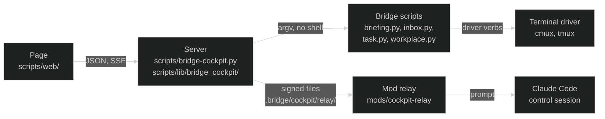

# Developing the Bridge cockpit

[`bridge-cockpit.md`](bridge-cockpit.md) is the user guide: switching it on, what the
page shows, the safety model, the relay, the files. This page is for changing it.

## 1. The three parts



- **Server** (Python stdlib only): collects the briefing, shapes it into one view
  model, polls the agent tabs, runs verbs, streams changes, writes relay records.
  All domain logic lives here; the page only renders.
- **Page** (Preact + htm, no build step): renders the model, sends verbs, holds
  only view state (selection, open drawers, the page tab).
- **Mod relay** (`mods/cockpit-relay`): the control session heartbeats, picks up
  signed questions and answers them as prompts. It does nothing else: no card,
  no command.

Everything the page does to an agent tab goes through `scripts/workplace.py`
and the terminal driver configured in `workplace.driver`
([`workplace.md`](workplace.md), "Writing a driver"): `workplace.py focus`
(Go to tab), `key` (Yes, No), `screen` (the large tab view), `close` (Close
tab), `send` (a message, Go on) and `launch` (Do it, Advise me). The server asks
`workplace.py caps --json` once and then every few minutes
(`server.py driver_caps`), and a verb in `actions.py NEEDS_CAP` is refused with
`driver_cannot` when the driver does not serve it. So the server calls no
terminal directly for a tab; the cmux CLI stays only for the layout backup
(`skills/cmux/scripts/cmux_layout.py`, every `snapshot_minutes` and on "Save
layout now").

## 2. Where things live

| File | Job |
|---|---|
| `scripts/bridge-cockpit.py` | CLI: serve, start, open, url, status, stop |
| `scripts/lib/bridge_cockpit/config.py` | reads `cockpit` (formerly `briefing.web`) from `bridge-config.yaml`; a key it leaves out (language, full_minutes, voice, launch.target, snapshot_minutes) falls back to `briefing.claude_code_ui` |
| `scripts/lib/bridge_cockpit/runner.py` | the one place that starts a subprocess: program allowlist, timeouts, clean env |
| `scripts/lib/bridge_cockpit/collector.py` | collect pipeline (quick, full, delta), and `build_model`: the JSON the page gets |
| `scripts/lib/bridge_cockpit/model.py` | pure domain functions, first ported from the retired briefing card's `logic.ts` (buckets, layout, tab matching) |
| `scripts/lib/bridge_cockpit/actions.py` | the verb table `SPEC`, argument checks, one `v_<verb>` handler per verb |
| `scripts/lib/bridge_cockpit/review.py` | the task check: `task.py review` on its own thread, the last run for the model |
| `scripts/lib/bridge_cockpit/sessions.py` | the Sessions page: running Claude sessions, their subagents and tab |
| `scripts/lib/bridge_cockpit/quick.py` | the chat: one short read-only `claude -p` per chat (Haiku default), streamed (`quick_live`), kept in `quick.json`, resume, cost per turn, handoff |
| `scripts/lib/bridge_cockpit/ticker.py` | the news ticker: settings (`cockpit.ticker` plus `ticker.json`), feed fetching and parsing (RSS, RDF, Atom), the cache `ticker-cache.json`, the Haiku editor on its own thread, and `state()`, the `ticker` key of the model and the payload of the SSE event `ticker` |
| `scripts/lib/bridge_cockpit/details.py` | read-only detail endpoints: a task's STATUS.md, an inbox item |
| `scripts/lib/bridge_cockpit/tabs.py` | tab poller over `workplace.py status --json` |
| `scripts/lib/bridge_cockpit/server.py` `driver_caps`, `backup_layout` | what the terminal driver serves; the cmux layout backup every `snapshot_minutes` |
| `scripts/lib/bridge_cockpit/watch.py` | stat-only watcher of `work/` and the relay folder |
| `scripts/lib/bridge_cockpit/relay.py` | relay records, HMAC signing, heartbeat reading |
| `scripts/lib/bridge_cockpit/store.py` | `state.json` (hidden rows, team runs) and `view.json` (last view) |
| `scripts/lib/bridge_cockpit/server.py` | HTTP: routes, auth, static files, SSE |
| `scripts/lib/bridge_cockpit/text.py` | server texts (notes, prompts to Claude), de and en |
| `scripts/web/index.html`, `theme.js` | page shell, light or dark before first paint |
| `scripts/web/app.js` | store, controller (`ctl`), event stream, keyboard |
| `scripts/web/components.js` | the root (`App`) and the page router; the rules every component keeps |
| `scripts/web/views/*.js` | the components, one file per area (header, day, detail, chat, tabs, pages, start page, stage, sessions, check, overlays, small parts, page ids); each reads the store `s`, calls the controller `c` and imports what it uses from the others |
| `scripts/web/views/ticker.js` | the news ticker: `TickerBand` on the start page and `TickerSettings`, its group on the Settings page, drawn with the page's own `Card`, `Row` and `Switch` from `views/settings.js` |
| `scripts/web/markdown.js` | the Markdown reader for answers (Chat, Other Bridges): text into plain blocks and runs, never HTML; `safeHref` keeps http(s) and mailto links only |
| `scripts/web/views/prose.js` | `Prose`: draws what `markdown.js` read as elements, links in a new tab with `noopener noreferrer` |
| `scripts/web/logic.js` | pure helpers, tested under node (the ticker's status rules are `tickerStatus` and `tickerItems`) |
| `scripts/web/motion.js` | springs, hits and rail points from the explainer films (`skills/explainer-video/assets/motion.js`), tested under node |
| `scripts/web/api.js` | fetch and EventSource wrappers |
| `scripts/web/text.js` | page texts, de and en with identical keys |
| `scripts/web/tokens.css`, `style.css` | design tokens from `DESIGN.md`, layout |
| `scripts/web/mock.js` | invented example data for `?mock=1` |
| `scripts/web/vendor/` | pinned Preact + htm bundle, checked by hash |
| `mods/cockpit-relay/hooks/relay.ts` | pure relay functions of the mod, HMAC included, and its word tables (`TABLES`) |
| `mods/cockpit-relay/hooks/register.tsx` | heartbeat, the relay loop |
| `skills/cockpit/SKILL.md` | `/cockpit`: runs `bridge-cockpit.py open --json` |

## 3. What is web only, and what is shared

Free to change without touching anything else:
`scripts/bridge-cockpit.py`, `scripts/lib/bridge_cockpit/`, `scripts/web/`, this page,
`bridge-cockpit.md` and the two test files.

Shared with the rest of the Bridge, so a change there reaches more than the page:

| Shared file | Who else uses it |
|---|---|
| `scripts/briefing.py` | the text briefing; the server reads `collect --json --no-save` |
| `scripts/inbox.py` | every session and the inbox runner |
| `scripts/task.py` | every session and `/briefing` (priority, note, close, review), taken from open-bridge#321 |
| `scripts/workplace.py` | `/briefing`, the workplace and every terminal driver (`skills/cmux`, `skills/tmux`) |
| `mods/cockpit-relay/` | the relay in the control session |
| `bridge-config.yaml.template` | every new instance |
| `scripts/categorize-commits.py`, `.github/workflows/validate.yml` | the promote check and CI |

A new capability the page needs from the Bridge (like closing a task) goes into
the shared script as a subcommand with its own tests, never into the server.
The server only calls it.

## 4. Edit loop

```bash
python3 scripts/bridge-cockpit.py open          # start if needed, open the page
python3 scripts/bridge-cockpit.py stop          # stop
python3 scripts/bridge-cockpit.py status --json
```

- **Page files** (`scripts/web/`): reload the browser. Static files go out with
  `Cache-Control: no-cache`, `index.html` with `no-store`.
- **Server files** (`scripts/lib/bridge_cockpit/`): `stop`, then `open`. A restart
  makes a new key, so an open tab shows the sign-in panel; `open` gives a fresh
  one.
- **Mod files**: `/reload-plugins` in the control session.
- **Mock mode**: take the link from `python3 scripts/bridge-cockpit.py url` and add
  `&mock=1` (the server serves even static files only with the key; the sign-in
  redirect keeps `mock`, `lang`, `offline`, `empty` and `auth`). The page then
  renders invented data and sends no request. Add `&lang=de`,
  `&offline=1`, `&empty=1`, `&auth=0`, `&theme=light` or `&theme=dark` (forces
  the mode for this load and saves nothing). Good for layout work; it does not
  exercise the server.
- **The demo on the website** (`docs/cockpit-demo/`) is a generated copy of
  `scripts/web/`, because GitHub Pages serves only `docs/`. After changing
  anything in `scripts/web/`, run `python3 scripts/build-cockpit-demo.py --write`
  and commit the copy with the change. It writes `colors.css` from `DESIGN.md`
  and an `index.html` that turns mock mode on by itself; CI runs
  `test_bridge_cockpit_demo.py`, which fails while the copy has drifted. In a
  configured instance (one with `bridge-config.yaml`) `colors.css` stays as
  open-bridge ships it: the demo shows open-bridge, so an instance's own
  `DESIGN.md` is neither checked against it nor written into it.
- **A second instance beside the live one**:
  `python3 scripts/bridge-cockpit.py --state-dir /tmp/bw-dev serve --port 8798`,
  its link from `python3 scripts/bridge-cockpit.py --state-dir /tmp/bw-dev url`,
  stopped with `... --state-dir /tmp/bw-dev stop`. Its own key, its own hidden
  rows, same data. Its relay stays offline: the `cockpit-relay` mod reads only
  `.bridge/cockpit/relay/`, so "ask Claude" works on the live instance only. Verbs still write to the real
  inbox and tasks.

## 5. Recipes

### A new verb

1. `actions.py`: an entry in `SPEC` (argument name to type and required), and a
   `v_<verb>(self, ctx, ...)` handler. Run programs only through `ctx.call(name,
   subject, argv, timeout)`, argv a list, free text after `--`. End with
   `self.settle(...)` when the row should disappear, or `ctx.delta()` when it
   only changed.
2. `runner.py`: only if a new program is needed; add it to the allowlist.
3. `text.py`: the note texts, in both tables.
4. `test_bridge_cockpit.py`: a test that asserts the exact argv (`writes(world)`
   with the helpers `I`, `K`, `W`, `C`), a refusal for a wrong row, and a bad
   argument in the injection list `test_argument_injection_is_rejected_before_any_call`.
5. the view under `views/`: the button, through `c.act(verb, args)`, or a controller
   method in `app.js` when it needs a confirmation (see `askTaskDone` and
   `confirmYes`).
6. `text.js`: button text in both languages.
7. `bridge-cockpit.md` section 4: the verb list.

Verb `task_close` is a complete small example of all seven, including the
refusal for streams (`closable` on the row) and the mock: a verb that settles a
row also goes into the settle list of `mock.js`.

A verb that takes long (minutes, a model call) does not hold the write lock:
`task_review` only starts `review.py` on its own thread and returns at once;
the model carries `review.running`, the end comes as a note and a rebuild.
One at a time, and `task_keep` waits for it, since both write the same file.

### The news ticker

The server sends only what the page cannot know: the feed items, the editor's
result and a small `perf` block (the last collect passes and the token
outliers). Every status item is built in the page from the store it already
holds, so a change of state shows on the band at once.

- **A new status item**: a rule in `tickerStatus` in `logic.js` (source in the
  store, condition, `cat`, `tone`, `target`), its text under `ticker.status`
  in `text.js` in both languages, and one store fixture for it in the frontend
  test. `cat` is one of the kinds in `ticker.STATUS_KINDS`; a new kind also goes
  into that tuple, the template comment and the kind chips of `TickerSettings`.
  `target.kind` must be one the page can open (`page`, `tab`, `drawer`, `info`,
  `row`, `review`, `workers`, `conv`, `claude`), or none.
- **A new default feed**: `DEFAULT_FEEDS` in `ticker.py` and the commented
  list in `bridge-config.yaml.template`. Check it first with `curl -sI` (200,
  an XML content type) and `curl -s | head` (no DOCTYPE, since the parser
  refuses one). CORE defaults name no instance (`test_bridge_cockpit_core.py`).
- **Events**: the ticker has one SSE event, `ticker`, in `EVENTS` in
  `api.js`. The server sends it after a settings change, after each feed read
  and when an edit starts and ends; the payload is the whole `state()`. The
  verbs `ticker_settings`, `ticker_settings_reset`, `ticker_refresh`,
  `ticker_edit` and `ticker_profile` return at once with `ticker` in the
  answer; the slow part runs on a thread and arrives as that event.
- **The selection without a model** is `merge_items(groups, max_items, smart,
  now_ms)`: mute, age, join (same address or title always, `same_story` on
  `title_words` with `cluster`), then each feed's turn when over `max_items`.
  A change of `smart` rebuilds from `feed_items` under the lock (`_rebuild`),
  never fetches. What is new since the last visit and what was opened are the
  page's (`ui.tickerSince`, `ui.tickerRead`, kept in `localStorage`), never the
  server's.
- **The interest profile** is a proposal, never a setting: `ticker_profile`
  with `llm: false` counts words of the open task titles (`profile_keywords`,
  at once), with `llm: true` asks Haiku on a thread (`profile_prompt`, same
  budget as the editor). The result stands in `state()["profile"]["last"]` until
  the next proposal; only the page's "Take" saves it into `editor.interests`.
- **The editor stays a click**: `ticker_edit` is called only from the Editor
  button. Never from an effect, a timer, the refresh loop, `state_payload()` or
  the server start; the frontend test checks the page side, the server test
  that no `claude` argv runs without the verb. The prompt stays under
  `model_route.HAIKU_PROMPT_MAX`, since a longer one is refused, not cut.
- **Fetching**: `Ticker(app, fetch=...)` takes the fetcher, so tests never
  touch the network. The loop reads only while a page is connected
  (`client_count() > 0`) and the last read is older than `refresh_minutes`.
- **Mock mode** carries the same shape (`TICKER_CONFIG`, `tickerState` in
  `mock.js`), with `example.org` links only, a slow pass so the "slow" item
  shows, and invented short titles after Editor.

### A new field on a row or the model

`collector.py` `row_out` (per row) or `build_model` (top level), then use it in
the view under `views/` that draws it. Add it to the matching `row()` in `mock.js` so mock mode keeps
the real shape, and assert it in a model test.

### New page text

`text.js`, both `en` and `de`, same key. The frontend test fails on a key
missing in one language, an empty value, an em or en dash, or an emoji.

## 6. Tests

```bash
pytest -q scripts/tests/test_bridge_cockpit*.py scripts/tests/test_task.py scripts/tests/test_task_review.py
pytest -q scripts/tests/test_bridge_cockpit_ticker.py scripts/tests/test_bridge_cockpit_core.py scripts/tests/test_bridge_cockpit_demo.py
node --test scripts/tests/bridge_cockpit_frontend.test.mjs scripts/tests/bridge_cockpit_jev.test.mjs scripts/tests/bridge_cockpit_markdown.test.mjs
python3 scripts/build-cockpit-demo.py --check
npx -y -p typescript@5.6.3 -c 'node mods/cockpit-relay/tests/pure.test.mjs'
claude plugin test mods/cockpit-relay        # engine tests, local only
```

Use the bare `pytest` binary: on some machines `python3` has no pytest module
while the `pytest` command runs under the interpreter that does.

The server tests are hermetic: a fake Bridge in a temp folder, a fake runner
that records every argv, the relay key in a temp folder. The frontend test also
holds the vendor hash, no inline script in `index.html`, no external URL in a
served file, no `innerHTML`, and the colour values against `DESIGN.md`. The
ticker's source colours are checked on the palette `design.py` resolves, so
the fallback chain counts; `BRIDGE_DESIGN_MD=/path/to/DESIGN.md` runs that
check against another fork's `DESIGN.md`, for example the generic open-bridge
one.

## 7. Rules the code keeps

- 127.0.0.1 only, one key per start, every POST with the key header and a
  matching `Origin`.
- No shell anywhere; every id checked by a regex anchored with `\Z` before it
  reaches an argv.
- One write at a time.
- Always `--no-save` on collect, so the page never moves the text briefing's
  baseline.
- Colours only from `DESIGN.md` tokens; no new library without pinning it in
  `vendor/` with its hash.
- Motion only through `motion.js` (`useTween`, `useClock`, `useHits` in
  `views/parts.js`), only on `transform` and `opacity`, never a CSS transition
  on a value; under reduced motion a value stands at its target. A drawing is
  complete at rest, its moving layer only adds (`DESIGN.md`, form 3).
- The relay only ever prompts the control session, never during a turn, never
  an agent tab.

## 8. Moving it to open-bridge

These travel together: the web-only files from section 3, `scripts/task.py` with
its test, `mods/cockpit-relay/`, the template block, the CI steps and the
`scripts/categorize-commits.py` allowlist entries (open-bridge `scripts/` is an
allowlist). Before that, merge the mod with any newer version upstream. The
build contract in the task folder is history, not reference; this page and the
tests are.
